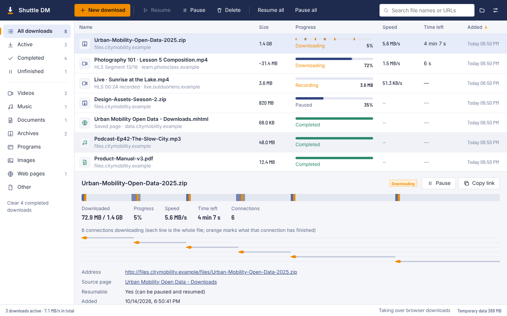
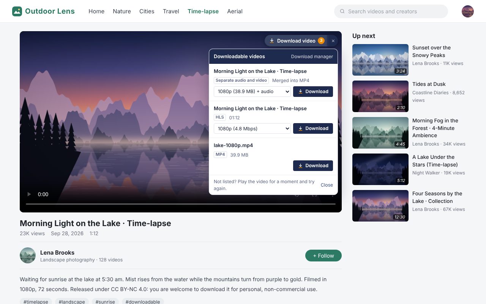
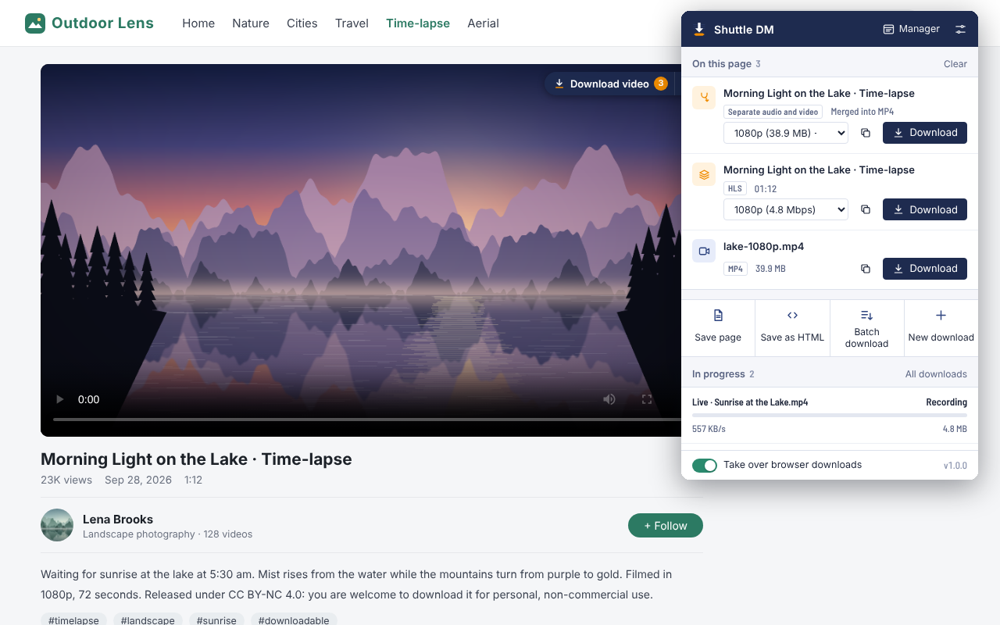

# Shuttle DM — Download Manager

**English** · [简体中文](README.zh-CN.md)

A fast download manager for Chrome and Edge that runs entirely in your browser: multi-connection downloads with pause and resume, one-click downloads of web videos (MP4, HLS/M3U8, separate audio and video tracks), saving pages and batch downloads.

The extension speaks English, 简体中文, Français, 日本語 and 한국어, following your browser's language.



| “Download video” on a web video | Toolbar popup |
| --- | --- |
|  |  |

More screenshots: [batch download](store/images/screenshots/en/4-batch-download.png) · [dark mode](store/images/screenshots/en/5-dark-mode.png)

## Features

| Feature | Details |
| --- | --- |
| Multi-connection downloads | The first request doubles as a probe. Files that support Range requests are split into parts downloaded in parallel; when one connection finishes early it takes over half of the largest remaining part, so a download never ends on a single slow connection. |
| Pause and resume | Data is written in 4 MB pieces to the extension's private storage (OPFS). Downloads continue after a pause, a network drop, a crash or a browser restart. ETag, Last-Modified and size are checked, and the download starts over if the file changed on the server. |
| Robust connections | Dropped connections reconnect and continue from where they stopped; a connection that receives nothing for 15 seconds is restarted; fewer connections are used when a server limits them. |
| Web video detection | Finds the MP4/WebM/FLV files, HLS (M3U8) streams and separate audio/video tracks that a page plays. The toolbar icon shows how many were found. |
| “Download video” button | Hover over a video and pick a quality from the button in its corner. Works for players in iframes and in full screen. |
| HLS (M3U8) | Reads multi-quality master playlists; supports AES-128 encrypted segments, fMP4 segments, byte ranges and separate audio renditions. Streams are remuxed into a standard MP4 **without re-encoding**; codecs that can't be remuxed (such as HEVC) are saved as TS. |
| Live recording | Records a live stream from now on until you click “Stop recording and save”. |
| Merging separate tracks | Video and audio tracks fetched separately (fragmented or regular MP4) are merged into one MP4, keeping timestamps and A/V sync. |
| Browser download takeover | Downloads the browser starts (archives, installers, documents, videos…) are handed to Shuttle DM. The engine first checks it can fetch the same file; if not, the browser carries on, so no download is lost. |
| Referer and cookies | Requests carry the Referer/Origin of the page the video came from, plus its cookies. Referer rules only apply to the extension's own requests. |
| Saving pages | As a single MHTML file (with images and styles, opens offline) or as an HTML snapshot. |
| Batch download | Lists every link, image, audio and video on the page or in your selection, with type filters and wildcard search. |
| Download manager | Categories, search, sorting, context menu and keyboard shortcuts; the details panel shows each connection live. |
| Also | Global speed limit, queue, folders by file type, notifications, dark mode, five languages. |

## Install

Chrome Web Store and Edge Add-ons links will be added here once the listings are approved. Until then, install it from this repository:

1. Download `shuttle-dm-<version>.zip` from [Releases](https://github.com/SAOCSB/shuttle-dm/releases) and unzip it, or clone this repository and use the `extension` folder.
2. Open `chrome://extensions` (`edge://extensions` in Edge) and turn on **Developer mode**.
3. Click **Load unpacked** and choose the folder that contains `manifest.json`.
4. Pin the extension to the toolbar so you can see when videos are found.

It needs Chrome 116 or later; Edge, Brave and other Chromium browsers work too.

## Using it

**Web videos**

- Play the video, click the toolbar icon, pick a quality under “On this page” and click **Download**.
- Or hover over the video and click **Download video** in its corner.
- Or right-click the video and choose **Download this video or audio with Shuttle DM**.

If nothing shows up, let the video play for a few seconds: many sites only request the stream after playback starts.

**Files**

- Right-click a link and choose **Download link with Shuttle DM**.
- Click **New download** in the manager or the popup and paste one or more links (one per line; `.m3u8` addresses work too).
- With **Take over browser downloads** on, just click download links as usual.

**Download manager** (`Alt+Shift+D`)

| Action | How |
| --- | --- |
| Pause / resume | Select and press Space, or double-click an unfinished download |
| Open a file | Double-click a finished download, or press Enter |
| Delete | Select and press Delete; you can also delete the file from your computer |
| Select several | Ctrl/⌘-click, Shift-click, Ctrl/⌘+A |
| New download | Ctrl/⌘+N |
| More | Right-click: show in folder, copy link, open source page, download again… |

**Settings**: connections per download, simultaneous downloads, speed limit, retries, subfolder, folders by file type, the video button, M3U8 output format (MP4/TS), which downloads to take over, and sites to leave alone.

## How it works

```
 Web page / player                      Background service worker
 ┌──────────────────┐   webRequest     ┌───────────────────────────────┐
 │ <video>, hls.js, │ ────────────────▶│ detects video/audio/HLS/tracks │
 │ download links   │                  │ context menus, takeover        │
 │ content.js:      │ ◀── messages ──▶ │ declarativeNetRequest: sets    │
 │ “Download video” │                  │   Referer/Origin on its own    │
 └──────────────────┘                  │   requests                     │
                                       └───────────────┬───────────────┘
 Popup / manager ◀── BroadcastChannel (live progress) ─┐ │ messages
                                                       │ ▼
                                       ┌───────────────────────────────┐
                                       │ Offscreen document: engine     │
                                       │  multi-connection Range        │
                                       │    downloads, dynamic splits   │
                                       │  HLS segments + AES-128        │
                                       │  mux.js: TS → fMP4             │
                                       │  MP4 muxer: fMP4 / tracks →    │
                                       │    standard MP4 (moov first)   │
                                       │  pieces stored in OPFS         │
                                       └───────────────┬───────────────┘
                                                       │ Blob URL
                                                       ▼
                                        chrome.downloads saves the file
```

- The engine runs in an [offscreen document](https://developer.chrome.com/docs/extensions/reference/api/offscreen), so it isn't stopped when the service worker sleeps; it closes itself after 5 idle minutes.
- Downloaded data goes to the extension's private file system first. When a download finishes, the pieces are joined into a disk-backed Blob (not held in memory), saved through `chrome.downloads`, and the temporary data is removed.
- The MP4 muxer (`extension/common/mp4.js`) reads `moof/trun` boxes or regular sample tables, writes a new `moov` (with edit lists to keep audio and video in sync) and references the media data as Blob slices.

## Limitations

Some limits come from the browser itself:

- **Connections**: browsers open at most 6 connections to one HTTP/1.1 server (the page's own requests included), so the default is 6 per download. HTTP/2 servers don't have this limit.
- **Disk space**: data is kept in the extension's storage until the download finishes and is then copied to your downloads folder, so large files temporarily need about twice their size.
- **DRM**: videos protected by Widevine, FairPlay or PlayReady (most paid streaming services) can't be downloaded. Shuttle DM says so and does not try to get around it.
- **YouTube**: not supported.
- **DASH**: `.mpd` manifests can't be downloaded directly, but the audio and video tracks a player fetches are detected and merged.
- **Codecs**: TS → MP4 supports H.264 + AAC; HEVC/H.265, AC-3 and others are saved as TS (VLC and PotPlayer play them).
- **Takeover**: downloads that need a form submission (POST) or a one-time token can't be requested again; the browser then finishes them itself. Downloads in incognito windows are not taken over.
- **Service workers on pages**: a few sites fetch video through their own service worker; the browser doesn't tie those requests to the tab, so they may not be detected.

Please only download content you have the right to save, and follow the terms of the websites you use.

## Privacy

Shuttle DM has no accounts, analytics or ads, and nothing leaves your computer. See the [privacy policy](PRIVACY.md).

## Project layout

```
extension/           the extension (this folder is what you load or package)
├── manifest.json
├── _locales/        translations: en, zh_CN, fr, ja, ko
├── background/      service worker: messages, menus, media detection, takeover, Referer rules
├── engine/          download engine (offscreen document): HTTP, HLS, OPFS storage, speed limit
├── common/          shared code: MP4 muxer, M3U8 parser, TS probe, detection rules, i18n
├── content/         the “Download video” button and panel
├── ui/              popup, download manager, settings, batch download page
└── icons/
tests/               test server, unit tests and browser tests (see tests/README.md)
store/               store listing texts, privacy answers and images
scripts/             build-zip.sh (store package), make-icons.py
```

## Development

- Load `extension/` with **Load unpacked**; reload it from `chrome://extensions` after changes.
- Tests: see [tests/README.md](tests/README.md).
- Translations live in `extension/_locales/<locale>/messages.json`. To add a language, copy `en/messages.json`, translate every `message`, add the locale to `LOCALES` in `extension/common/i18n.js`, and run `npm run test:unit` in `tests/` — it checks that every locale has every message with the same placeholders.
- Package for the stores: `bash scripts/build-zip.sh` creates `dist/shuttle-dm-<version>.zip`.

## License

MIT, see [LICENSE](LICENSE). Third-party components:

- [mux.js](https://github.com/videojs/mux.js) (Apache License 2.0), see `extension/engine/vendor/mux.js.LICENSE`
- Barlow Semi Condensed font (SIL Open Font License 1.1), see `extension/ui/fonts/OFL.txt`
