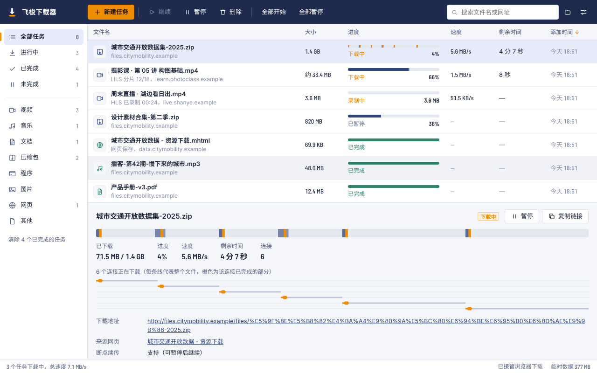
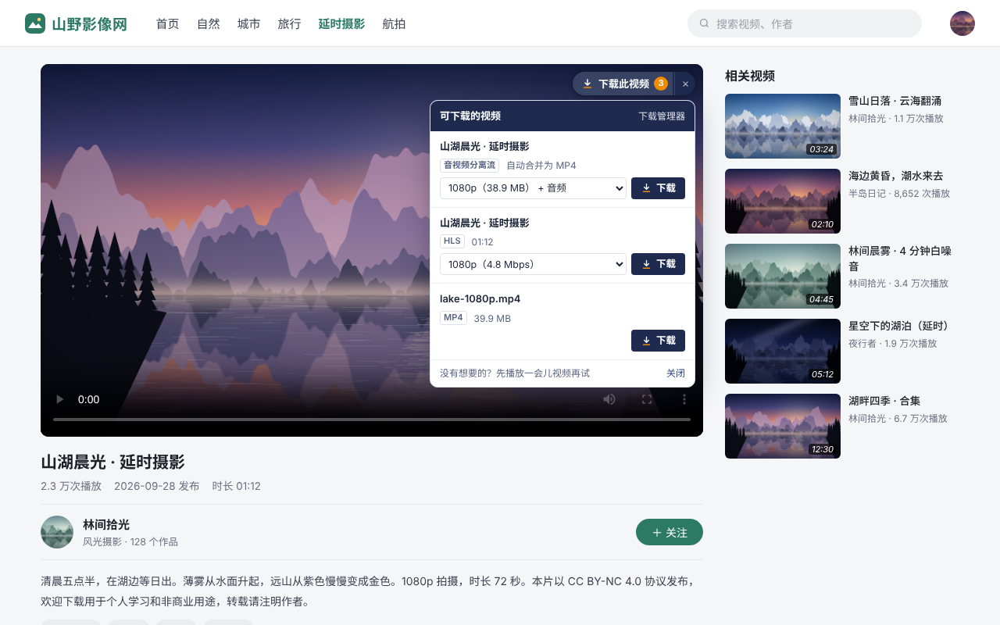

# 飞梭下载器 · Shuttle DM

[English](README.md) · **简体中文**

一个完全在浏览器里运行的 Chrome / Edge 下载管理器：多线程分段下载、断点续传，一键下载网页视频（MP4、HLS/M3U8、分离的音视频轨道），保存网页，批量下载。

扩展界面支持 English、简体中文、Français、日本語、한국어，跟随浏览器语言自动切换。

| 视频上的“下载此视频” | 工具栏弹出窗口 |
| --- | --- |
|  |  |

更多截图：[批量下载](store/images/screenshots/zh-CN/4-batch-download.png) · [深色模式](store/images/screenshots/zh-CN/5-dark-mode.png)

## 功能

| 功能 | 说明 |
| --- | --- |
| 多线程分段下载 | 首个请求兼做探测，支持 Range 的文件自动切成多段并发下载；某个连接先完成时，会接手剩余最多那一段的后一半（动态分段），下载不会拖在最后一个慢连接上。 |
| 断点续传 | 数据以 4 MB 为单位写入扩展的私有存储（OPFS）。暂停、断网、浏览器崩溃或重启后都能从断点继续；会校验 ETag、修改时间和文件大小，远端文件变了会自动重新下载。 |
| 连接容错 | 连接中断自动重连并从断点继续；15 秒收不到数据的连接会被主动重连；服务器限制并发连接时自动减少连接数。 |
| 网页视频检测 | 识别网页播放的 MP4/WebM/FLV 等文件、HLS（M3U8）视频流和分开传输的音视频轨道，工具栏图标显示检测到的数量。 |
| “下载此视频”按钮 | 鼠标移到视频上，在右上角的按钮里选择清晰度即可下载。支持 iframe 内嵌播放器和全屏。 |
| HLS（M3U8） | 解析多清晰度主列表；支持 AES-128 加密分片、fMP4 分片、字节范围和独立音轨；**不重新编码**，无损转封装为标准 MP4。HEVC 等无法转封装的编码保存为 TS。 |
| 直播录制 | 从当前位置开始录制直播流，点“停止录制并保存”后生成文件。 |
| 合并分离的音视频 | 分别获取的视频轨和音频轨（分片 MP4 或普通 MP4）自动合并为一个 MP4，保留原始时间轴和音画同步。 |
| 接管浏览器下载 | 浏览器自己的下载（压缩包、安装包、文档、视频等）交给飞梭多线程下载。会先确认能重新请求到同一个文件，否则让浏览器照常下载，不会丢失下载。 |
| Referer 与 Cookie | 请求会带上视频所在网页的 Referer/Origin 和 Cookie。Referer 规则只作用于本扩展自己发出的请求。 |
| 保存网页 | 保存为单个 MHTML 文件（含图片和样式，可离线打开）或 HTML 快照。 |
| 批量下载 | 列出网页或选中区域里的全部链接、图片和音视频，可按类型筛选、用通配符搜索。 |
| 下载管理器 | 分类、搜索、排序、右键菜单和快捷键；详情面板实时显示每个连接的进度。 |
| 其他 | 全局限速、任务队列、按文件类型分文件夹、完成通知、深色模式、五种界面语言。 |

## 安装

上架 Chrome 应用商店和 Edge 加载项商店后会在这里提供链接。在此之前可以从本仓库安装：

1. 在 [Releases](https://github.com/SAOCSB/shuttle-dm/releases) 下载 `shuttle-dm-<版本>.zip` 并解压；或者克隆本仓库，使用其中的 `extension` 文件夹。
2. 打开 `chrome://extensions`（Edge 为 `edge://extensions`），打开右上角的“开发者模式”。
3. 点击“加载已解压的扩展程序”，选择包含 `manifest.json` 的文件夹。
4. 建议把扩展固定到工具栏，方便查看检测到的视频。

需要 Chrome 116 或更新版本；Edge、Brave 等基于 Chromium 的浏览器同样可用。

## 使用

**下载网页视频**

- 播放视频后点击工具栏图标，在“本页可下载”里选择清晰度，点“下载”。
- 或者把鼠标移到视频上，点击右上角的“下载此视频”。
- 也可以右键视频，选择“用飞梭下载此视频/音频”。

如果列表为空，先让视频播放几秒（很多网站在开始播放后才请求视频）。

**下载文件**

- 右键链接，选择“用飞梭下载此链接”。
- 在管理器或弹出窗口里点“新建任务”，粘贴一个或多个链接（每行一个，也支持 `.m3u8` 地址）。
- 开启“接管浏览器下载”后，直接点击网页上的下载链接即可。

**下载管理器**（快捷键 `Alt+Shift+D`）

| 操作 | 方式 |
| --- | --- |
| 暂停 / 继续 | 选中后按空格，或双击未完成的任务 |
| 打开文件 | 双击已完成的任务，或按回车 |
| 删除 | 选中后按 Delete，可选择同时删除电脑上的文件 |
| 多选 | Ctrl/⌘ 点击、Shift 连选、Ctrl/⌘+A 全选 |
| 新建任务 | Ctrl/⌘+N |
| 更多操作 | 右键任务：在文件夹中显示、复制链接、打开来源网页、重新下载等 |

**设置**：每个任务的连接数、同时下载的任务数、全局限速、重试次数、保存子文件夹、按类型分文件夹、视频按钮开关、M3U8 保存格式（MP4/TS）、接管哪些浏览器下载以及不接管的网站。

## 工作原理

- 下载引擎运行在 [Offscreen 文档](https://developer.chrome.com/docs/extensions/reference/api/offscreen) 中，不受 Service Worker 休眠影响；空闲 5 分钟后自动关闭释放内存。
- 下载数据先写入扩展的私有文件系统（OPFS），完成后拼成一个引用磁盘文件的 Blob（不占内存），通过 `chrome.downloads` 保存到下载目录，再清理临时数据。
- MP4 合并器（`extension/common/mp4.js`）解析分片 MP4 的 `moof/trun` 或普通 MP4 的样本表，重新生成 `moov`（带编辑列表以保持音画同步），媒体数据以 Blob 切片的形式引用原文件。

结构图见[英文说明](README.md#how-it-works)。

## 限制

有些限制来自浏览器本身：

- **连接数**：浏览器对同一个 HTTP/1.1 服务器最多建立 6 个连接（包括网页自己的请求），所以默认每个任务 6 个连接；HTTP/2 服务器不受此限制。
- **磁盘空间**：下载中的数据先存在扩展的存储空间里，完成后再复制到下载目录，大文件下载时临时需要约两倍的空间。
- **DRM**：使用 Widevine、FairPlay、PlayReady 等版权保护的视频（多数付费影视平台）无法下载，飞梭会直接提示，不会尝试绕过。
- **YouTube**：不支持。
- **DASH**：`.mpd` 清单不能直接下载，但播放器实际获取的音视频轨道可以被检测并合并。
- **编码**：TS 转 MP4 支持 H.264 + AAC；HEVC/H.265、AC-3 等保存为 TS（VLC、PotPlayer 可直接播放）。
- **接管**：需要提交表单（POST）或一次性令牌的下载无法重新请求，这时由浏览器照常完成；隐身窗口中的下载不接管。
- **网页 Service Worker**：极少数网站通过自己的 Service Worker 获取视频，浏览器不会把这些请求关联到标签页，可能检测不到。

请只下载你有权保存的内容，并遵守所访问网站的使用条款。

## 隐私

飞梭下载器没有账号、没有统计、没有广告，任何数据都不会离开你的电脑。详见[隐私政策](PRIVACY.md)。

## 开发

- 用“加载已解压的扩展程序”加载 `extension/`，修改后在 `chrome://extensions` 里重新加载。
- 测试方法见 [tests/README.md](tests/README.md)。
- 翻译文件在 `extension/_locales/<语言>/messages.json`。新增语言时复制 `en/messages.json` 翻译所有 `message`，把语言加入 `extension/common/i18n.js` 的 `LOCALES`，然后在 `tests/` 里运行 `npm run test:unit`，它会检查每种语言的消息和占位符是否齐全。
- 打包上架用的压缩包：`bash scripts/build-zip.sh`，生成 `dist/shuttle-dm-<版本>.zip`。
- 上架步骤见 [store/PUBLISHING.zh-CN.md](store/PUBLISHING.zh-CN.md)。

## 许可证

MIT，见 [LICENSE](LICENSE)。第三方组件：

- [mux.js](https://github.com/videojs/mux.js)（Apache License 2.0），见 `extension/engine/vendor/mux.js.LICENSE`
- Barlow Semi Condensed 字体（SIL Open Font License 1.1），见 `extension/ui/fonts/OFL.txt`
